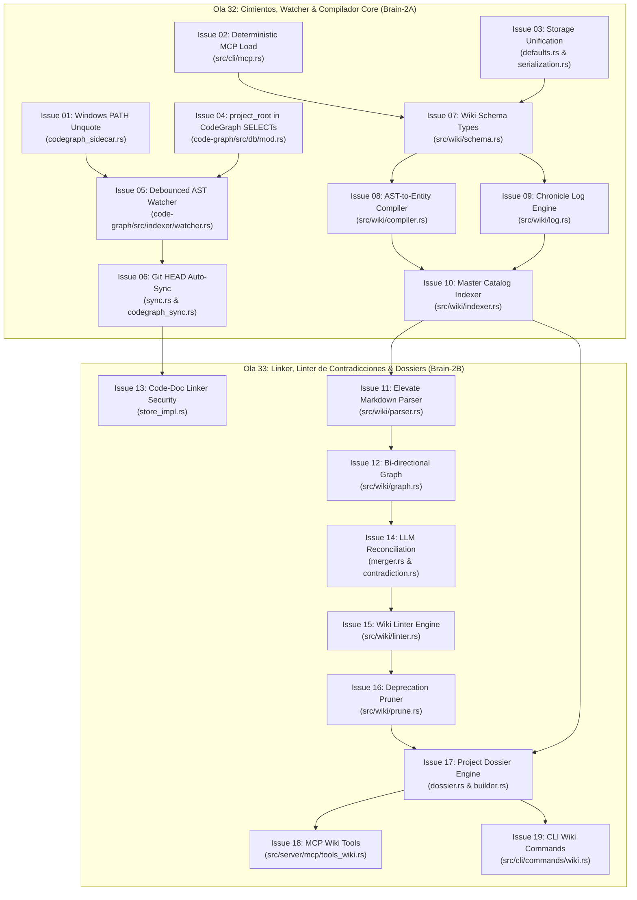

# Ola 32 & 33: Wave Brain-2 — Karpathy Living Knowledge Engine (Second Brain)

> **Protocolo GitCore:** v3.8.0  
> **Target Release:** Xavier v1.1.0  
> **Base Branch:** `main` (commit canónico `483824f9`)  
> **Directorio de Issues:** `.gitcore/issues/wave-brain2/`  

---

## 1. Resumen de la Ola

Transforma a Xavier de un motor de búsqueda vectorial pasivo (RAG tradicional) a un **Segundo Cerebro Compilado en Markdown** (*Compiled Knowledge Base / LLM Wiki*) según la arquitectura propuesta por Andrej Karpathy.

### Principios Arquitectónicos
1. **Compilación Continua vs Búsqueda sin Estado:** El código y los eventos no se buscan en crudo; se compilan al modificarse en fichas vivas de Markdown (`entities/`, `concepts/`, `index.md`, `log.md`).
2. **Reconciliación Semántica de Contradicciones:** Cuando un hecho nuevo colisiona con uno antiguo, el LLM resuelve el conflicto y actualiza la entidad canónica en vez de concatenar oraciones opuestas.
3. **Dossiers de Proyecto Exactos:** `get_project_context` entrega resúmenes arquitectónicos limpios y hubs de código, podando el 100% de la telemetría de terminales y cron ticks.
4. **Resiliencia en Windows:** Erradica el error Win32 123 en sidecars y unifica el almacenamiento en `AppData\Local\xavier`.

---

## 2. Árbol de Dependencias de Tareas

---

## 3. Matriz de Micro-Issues y File Islands (100% Disjuntos)

### Ola 32 (Brain-2A: Issues 01 al 10)
| # | Issue File | Feature ID | Archivo Modificable (Exclusivo) |
|---|---|---|---|
| 01 | `issue-01-feat-codegraph-windows-path-unquote.md` | `feat-codegraph-windows-path-unquote` | `src/codebase/codegraph_sidecar.rs` |
| 02 | `issue-02-feat-mcp-codegraph-deterministic-load.md` | `feat-mcp-codegraph-deterministic-load` | `src/cli/mcp.rs` |
| 03 | `issue-03-feat-storage-path-unification.md` | `feat-storage-path-unification` | `src/settings/defaults.rs`, `src/settings/serialization.rs` |
| 04 | `issue-04-feat-codegraph-project-root-preservation.md` | `feat-codegraph-project-root-preservation` | `code-graph/src/db/mod.rs` |
| 05 | `issue-05-feat-codegraph-reactive-watcher.md` | `feat-codegraph-reactive-watcher` | `code-graph/src/indexer/watcher.rs`, `code-graph/src/indexer/mod.rs` |
| 06 | `issue-06-feat-git-head-auto-sync.md` | `feat-git-head-auto-sync` | `src/codebase/sync.rs`, `src/cli/codegraph_sync.rs` |
| 07 | `issue-07-feat-wiki-schema-types.md` | `feat-wiki-schema-types` | `src/wiki/schema.rs`, `src/wiki/mod.rs` |
| 08 | `issue-08-feat-wiki-ast-entity-compiler.md` | `feat-wiki-ast-entity-compiler` | `src/wiki/compiler.rs` |
| 09 | `issue-09-feat-wiki-chronicle-log.md` | `feat-wiki-chronicle-log` | `src/wiki/log.rs` |
| 10 | `issue-10-feat-wiki-master-catalog.md` | `feat-wiki-master-catalog` | `src/wiki/indexer.rs` |

### Ola 33 (Brain-2B: Issues 11 al 19)
| # | Issue File | Feature ID | Archivo Modificable (Exclusivo) |
|---|---|---|---|
| 11 | `issue-11-feat-wiki-markdown-parser-elevation.md` | `feat-wiki-markdown-parser-elevation` | `src/wiki/parser.rs` |
| 12 | `issue-12-feat-wiki-bidirectional-graph.md` | `feat-wiki-bidirectional-graph` | `src/wiki/graph.rs` |
| 13 | `issue-13-feat-codedoc-symbol-linker-security.md` | `feat-codedoc-symbol-linker-security` | `src/memory/sqlite_vec_store/store_impl.rs` |
| 14 | `issue-14-feat-consolidation-llm-reconciliation.md` | `feat-consolidation-llm-reconciliation` | `src/consolidation/merger.rs`, `src/consolidation/contradiction.rs` |
| 15 | `issue-15-feat-wiki-linter-engine.md` | `feat-wiki-linter-engine` | `src/wiki/linter.rs` |
| 16 | `issue-16-feat-wiki-stale-deprecation-pruner.md` | `feat-wiki-stale-deprecation-pruner` | `src/wiki/prune.rs` |
| 17 | `issue-17-feat-context-project-dossier.md` | `feat-context-project-dossier` | `src/context/dossier.rs`, `src/context/builder.rs` |
| 18 | `issue-18-feat-wiki-mcp-tools.md` | `feat-wiki-mcp-tools` | `src/server/mcp/tools_wiki.rs`, `src/server/mcp/session.rs` |
| 19 | `issue-19-feat-wiki-cli-commands.md` | `feat-wiki-cli-commands` | `src/cli/commands/wiki.rs`, `src/cli/commands/enums.rs` |

---

## 4. Protocolo de Ejecución y Despacho de Agentes

1. **Fase 1 (Completada):** Especificación canónica de issues, diagramas y contratos de verificación.
2. **Fase 2 (Despacho Ola 32):** Lanzar agentes autónomos asignados individualmente a los issues 01 al 10. Cada issue contiene acceptance criteria estrictamente verificables por comandos.
3. **Fase 3 (Verificación Ola 32):** Ejecutar `./scripts/verify-pipeline.sh`.
4. **Fase 4 (Despacho Ola 33):** Lanzar agentes para los issues 11 al 19 sobre los cimientos de la Ola 32.
5. **Fase 5 (Cierre):** Verificación E2E de compilación de wiki en el propio repo de Xavier.
