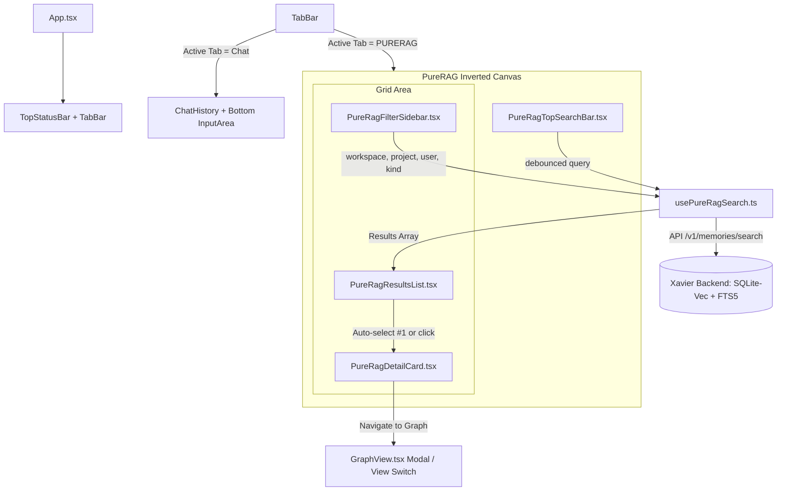

# FEATURE: PureRAG Real-Time Retrieval Explorer & Graph Traceability

**Base:** `origin/main` | **ADR:** ADR-037 (Planned) | **REQ:** REQ-086, REQ-087  
**Ledger:** `feat-purerag-explorer` | **Status:** `planned` | **Category:** `ui / search`

---

## 1. Executive Summary & Problem Statement

Standard conversational interfaces in agent runtimes rely heavily on generative LLMs to synthesize answers. While powerful, this introduces latency, potential hallucinations, token expenditures, and obscures the ground-truth provenance of stored memories.

**PureRAG** introduces a dedicated, high-performance **Zero-AI retrieval mode** embedded directly into the primary chat window of Xavier. Instead of generating conversational prose through an LLM, PureRAG performs **real-time, keystroke-reactive hybrid search** (Vector Embeddings + BM25 Lexical FTS5 + PageIndex hierarchical trees) directly against the local and federated memory store.

### Key Tenets
1. **Zero Generative AI:** Absolutely no LLM tokens or text generation models are invoked during search. Queries execute strictly via high-speed vector distance (`sqlite-vec`) and full-text index matching (`FTS5`).
2. **Inverted Layout Paradigm:** Unlike traditional chat windows where input is anchored at the bottom and messages scroll upwards, PureRAG anchors the search input at the **top**, cascading search results downward into an ergonomic split-pane layout.
3. **Real-Time Keystroke Reactivity:** Search results update on-the-fly as the user types (with optimized 150ms client-side debouncing and token caching).
4. **Strict Similarity Ordering:** Results are strictly ranked by similarity percentage ($\% \text{ Match}$), with the highest-ranked result automatically placed at the top and selected by default.
5. **Two-Column Split Explorer:**
   - **Column 1 (Primary Text Results):** Ranked snippet cards with similarity percentage badges, keyword highlights, and quick selection.
   - **Column 2 (Traceability & Detail Card):** In-depth provenance inspector detailing exact source path/URI, creation timestamp, author/user/agent identity, and connected relationship graph.
6. **Information Graph Bridge:** Instant one-click action to transition from a selected document card directly into Xavier's **Information Graph View** (`GraphView`), centering and highlighting the corresponding node and its 1st-degree relational network.
7. **Scoped Lateral Filters:** Granular sidebar filters to isolate results by Workspace (`swal/{app_id}/{instance_id}`), Project, Shared User / Contributor, Memory Kind, and Similarity Thresholds.
8. **Future-Proof Multimodal Foundation:** Built-in architectural specifications and data models to seamlessly extend PureRAG to Image (CLIP/SigLIP bounding-box retrieval) and Video (temporal keyframe timestamping and scene retrieval).

---

## 2. Inverted UI/UX Architecture & Layout Topology

### 2.1 Tab Switcher in Main Window Header
At the top of Xavier's primary chat canvas, a dual-mode tab switcher allows switching between conversational chat and pure retrieval:

```
┌─────────────────────────────────────────────────────────────────────────────────────────────────────────────────┐
│ [TopStatusBar: System Health | RAM | CPU | Active Node: swal/xavier/main | Sync: Green]                        │
├─────────────────────────────────────────────────────────────────────────────────────────────────────────────────┤
│  [💬 Chat (LLM Assistant)]   |   [⚡ PURERAG (Zero-AI Real-Time Retrieval)]   <-- Active Tab                     │
└─────────────────────────────────────────────────────────────────────────────────────────────────────────────────┘
```

### 2.2 Wireframe Layout Diagram (ASCII)

```
┌─────────────────────────────────────────────────────────────────────────────────────────────────────────────────┐
│ 🔍 Top Input: [ search phrase or keyword...                                             ] [Clear] [Mode: Fast]   │
├─────────────────┬──────────────────────────────────────────────┬────────────────────────────────────────────────┤
│ 🏷️ FILTERS       │ 📄 MATCHING TEXT SNIPPETS (Sorted by % Match) │ 📇 TRACEABILITY & METADATA CARD (Selected Doc) │
│ (Lateral Panel) │                                              │                                                │
│                 │ [Rank #1 | 98.4% Match] ⭐ AUTO-SELECTED       │ Document: "ARCHITECTURE.md"                     │
│ Workspace:      │ Path: docs/SRS/ARCHITECTURE.md#L45           │ ID: mem_8f92a10b4c2                            │
│ [ swal/xavier ] │ "...reciprocal rank fusion combines BM25     │ Similarity: 98.4%                              │
│                 │ and vector retrieval with zero LLM cost..."   │                                                │
│ Project:        │ ──────────────────────────────────────────── │ 📍 Location: docs/SRS/ARCHITECTURE.md:45       │
│ [ All Projects] │ [Rank #2 | 87.1% Match]                      │ 🕒 Created: 2026-10-14 08:32:10 UTC            │
│                 │ Path: src/search/rrf.rs#L112                 │ 👤 Author: iberi22 (Agent: Jules / GitCore)   │
│ Shared User:    │ "...fn compute_rrf_score calculates..."      │ 🔐 Clearance: Internal (L2)                    │
│ [ @belal      ] │ ──────────────────────────────────────────── │ 🏷️ Kind: doc / technical-spec                  │
│                 │ [Rank #3 | 74.5% Match]                      │ ────────────────────────────────────────────── │
│ Kind:           │ Path: .gitcore/features.json                 │ 🔗 Connected Relationships:                    │
│ [☑ doc ☑ code ] │ "...feat-hybrid-search: stable..."           │ ├─ Parent: REQ-083 (Page-Index Arm)            │
│                 │ ──────────────────────────────────────────── │ ├─ Linked Symbols: `query_with_embedding`      │
│ Min Similarity: │ [Rank #4 | 62.0% Match]                      │ └─ Tags: #vector, #hybrid, #rrf                │
│ [=====o===] 60% │ Path: panel-ui/src/components/GraphView.tsx  │ ────────────────────────────────────────────── │
│                 │ "...force-directed layout nodes..."          │ [ 🌐 Open in Information Graph View ]          │
│ Date Horizon:   │                                              │                                                │
│ [ Last 30 Days] │                                              │                                                │
└─────────────────┴──────────────────────────────────────────────┴────────────────────────────────────────────────┘
```

### 2.3 Component Hierarchy in `panel-ui`



---

## 3. Detailed Component Specifications

### 3.1 Top-Anchored Search Input (`PureRagTopSearchBar.tsx`)
- **Positioning:** Fixed at the top of the `PURERAG` workspace, occupying full width with glassmorphic styling (`bg-slate-900/60 backdrop-blur-md border-b border-white/10`).
- **Keystroke Reactivity:** Utilizes `useDebounce(query, 150)` for instant typeahead without server exhaustion.
- **Visual Feedback:**
  - Real-time search latency indicator (e.g. `⚡ 18ms · 42 docs matched · Zero-AI Mode`).
  - Clear query button (`Esc` shortcut).
  - Quick-toggle for search modes: `Hybrid (Vector + BM25)` vs `Exact Lexical (BM25 Only)`.

### 3.2 Lateral Filter Sidebar (`PureRagFilterSidebar.tsx`)
Collapsible left-side filter panel enabling precise namespace isolation:
- **Workspace Filter:** Multi-instance Xavier namespaces (`default`, `swal/hosteler-ia`, `swal/shelf`, `swal/xavier`).
- **Project Filter:** Project-specific scopes parsed from metadata (`xavier`, `core`, `code-graph`, `panel-ui`).
- **Shared User / Identity Filter:** Authorship attribution filter (`user_id`, `author_pubkey`, `agent_id`).
- **Memory Kind Selector:** Filter by memory kind badges (`doc`, `code`, `note`, `fact`, `preference`, `session`, `git-commit`).
- **Similarity Threshold Slider:** Min score filter (0% to 100%, default: 50%).
- **Date Horizon:** `All Time`, `Past 24 Hours`, `Past 7 Days`, `Past 30 Days`, or custom date range.
- **Modality Filter (Ready for Multimodal):** `Text & Code` (Default), `Images & Bounding Boxes`, `Video & Scenes`.

### 3.3 Block 1: Primary Results List (`PureRagResultsList.tsx`)
- **Ordering Guarantee:** Results are sorted **strictly descending** by similarity score:
  $$\text{Similarity \%} = \min(100.0, \max(0.0, \text{Score} \times 100))$$
- **Automatic Default Selection:** When a query resolves or changes, the top result (`index === 0`, highest similarity %) is **automatically selected**, immediately populating the Detail Card in Block 2.
- **Card Contents:**
  - Ranked index pill (`#1`, `#2`, `#3`).
  - Dynamic Similarity Badge:
    - $\ge 90\%$: Emerald Neon (`bg-emerald-500/20 text-emerald-400 border-emerald-500/40`)
    - $75\% - 89\%$: Cyan Neon (`bg-cyan-500/20 text-cyan-400 border-cyan-500/40`)
    - $50\% - 74\%$: Amber (`bg-amber-500/20 text-amber-400 border-amber-500/40`)
    - $< 50\%$: Slate Muted (`bg-slate-500/20 text-slate-400 border-slate-500/40`)
  - Target Path breadcrumbs (`docs/SRS/REQUIREMENTS.md#L120`).
  - Text Excerpt with matched keywords highlighted via `<mark className="bg-yellow-500/30 text-yellow-200">`.
  - Timestamp & Author summary pills.

### 3.4 Block 2: Traceability & Detailed Metadata Card (`PureRagDetailCard.tsx`)
Inspects the active item selected from Block 1:
- **Header:** Title, full path, document UUID, and "Copy Markdown Citation" button.
- **Geographic / Path Coordinates:** Exact file path, repo URL, start/end line numbers, virtual page index.
- **Temporal Traceability:**
  - `Written / Indexed:` ISO 8601 timestamp + human-readable relative time ("2 hours ago").
  - `Last Modified:` Timestamp of underlying source file or memory mutation.
- **Identity & Authorship:**
  - Creator User ID / Agent ID (`Jules`, `Hermes`, `Antigravity`, or Human user).
  - Cryptographic node signature / BIP39 node identity if originating from SWAL mesh.
- **Full Text / Code Inspection:** Syntax-highlighted view of the full snippet/document body with line numbers.
- **Relational Connectivity Network:**
  - L0/L1/L2 Belief Graph level (`Observation`, `Fact`, `Belief`).
  - Parent document and child chunk references (`parent_id`, `cluster_id`).
  - Cross-referenced symbols and files (`relatedFiles`, `decisions`).
- **Interactive Information Graph Button:**
  - Prominent CTA: `[ 🌐 Explore in Information Graph ]`.
  - When clicked: Switches or opens the `GraphView` with the selected node focused at $(x=0, y=0, zoom=2.0)$, highlighting all linked 1st and 2nd degree nodes.

---

## 4. Graph Navigation Integration Mechanics

Xavier contains a rich graph explorer in `panel-ui/src/components/GraphView.tsx` powered by `react-force-graph-2d` and backend endpoints `/memory/graph/view` and `/code/graph/view`.

### Navigation Workflow:
1. When user clicks `[ Explore in Information Graph ]` in `PureRagDetailCard`:
2. The UI invokes `onNavigateToGraph(nodeId, nodeType)`.
3. If inside `App.tsx`, it opens the Information Graph overlay or sets `mainTab = 'graph'`.
4. It calls `GraphView.centerAt(node.x, node.y, 400)` and highlights all connecting edges (`GraphLink`) matching `link.source === nodeId || link.target === nodeId`.
5. A breadcrumb ribbon at the top of the graph allows returning directly to `[ Back to PureRAG ]` preserving the search query and scroll state.

---

## 5. Future-Proof Multimodal RAG Extension (Video & Image)

PureRAG is designed as a multimodal-ready retrieval engine. Below is the architectural contract to incorporate video and image documents without breaking existing text pipelines:

### 5.1 Multimodal Schema Definition

```typescript
export type ModalityType = "text" | "code" | "image" | "video" | "audio";

export interface MultimodalMetadata {
  modality: ModalityType;
  mime_type: string;
  source_uri: string;             // file:///..., https://..., or ipfs://...
  thumbnail_uri?: string;         // Optimized WebP thumbnail preview

  // Spatial Grounding (Images & Video Keyframes)
  spatial?: {
    bounding_box?: [number, number, number, number]; // [ymin, xmin, ymax, xmax] normalized
    patch_index?: number;
    detected_labels?: string[];
    ocr_text?: string;
  };

  // Temporal Grounding (Video & Audio)
  temporal?: {
    start_time_ms: number;
    end_time_ms: number;
    duration_ms: number;
    fps?: number;
    keyframe_timestamp_ms?: number;
    scene_id?: string;
    transcript_segment?: string;
  };
}
```

### 5.2 Multimodal Embedding & Search Flow
- **Image Embeddings:** Extracted via CLIP (ViT-B/32 or ViT-L/14) or SigLIP local ONNX models into a unified 512/768-dimensional space.
- **Video Embeddings:**
  - Processed using dynamic scene change detection (PySceneDetect / FFmpeg keyframe extraction).
  - Keyframes embedded via SigLIP vision encoder; audio channels transcribed via Whisper and embedded via text vectors.
  - Search queries match against both visual frame vectors and transcript text vectors.
- **UI Presentation in PureRAG:**
  - **Results List:** For an image match, displays a compact thumbnail with an overlay of the similarity % and matching detected objects. For a video match, displays a video scene snapshot with timestamp badges (e.g. `▶ 02:14 - 02:45`).
  - **Detail Card:**
    - Images: Interactive high-res viewer with bounding box overlay highlights.
    - Video: HTML5 video player auto-seeking to `start_time_ms` with playback looping for the matched scene.
  - **Information Graph:** Media nodes render image avatars and temporal transition links (`scene_next`, `audio_sync`).

---

## 6. Backend API Contracts & Data Flow

### 6.1 Real-Time Search Endpoint (`POST /v1/memories/search`)

```json
{
  "query": "hybrid reciprocal rank fusion",
  "limit": 30,
  "mode": "snippet",
  "filters": {
    "workspace_id": "swal/xavier",
    "project": "xavier",
    "user_id": "iberi22",
    "kinds": ["doc", "code"],
    "retrieval_scope": "local_and_federated",
    "path_prefix": "docs/"
  }
}
```

### 6.2 Normalization and Scoring Algorithm
In PureRAG, similarity percentages are computed deterministically without LLM interpretation:
1. For cosine vector similarity:
   $$\text{Sim}_{\text{vector}} = \frac{1 + \cos(\mathbf{q}, \mathbf{d})}{2} \times 100\%$$
2. For Reciprocal Rank Fusion (RRF) hybrid results:
   $$\text{Score}_{\text{RRF}} = \sum_{m \in \{\text{vector}, \text{bm25}\}} \frac{w_m}{k + \text{rank}_m(d)}$$
   Normalized into a calibrated percentile $[0\%, 100\%]$ based on the active corpus score distribution.

---

## 7. Acceptance & Verification Criteria

1. **Zero-AI Guarantee:** Audited network and runtime verification confirms 0 calls to OpenAI, Claude, Ollama, or Gemini during PureRAG search executions.
2. **Inverted Layout:** Top search bar remains pinned; results cascade downwards in the two-column split.
3. **Auto-Selection:** The #1 ranked result (highest %) is selected automatically upon search response receipt.
4. **Graph Navigation:** Clicking `Explore in Information Graph` from the Detail Card opens the graph centered on the selected document's entity node.
5. **Filters Isolation:** Applying a Workspace or Project filter strictly excludes documents outside that boundary.
6. **Multimodal Readiness:** Metadata types and UI cards accommodate image and video schemas without breaking text-only records.
